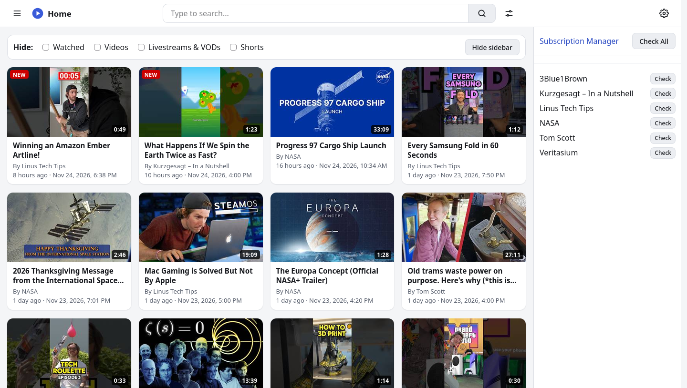
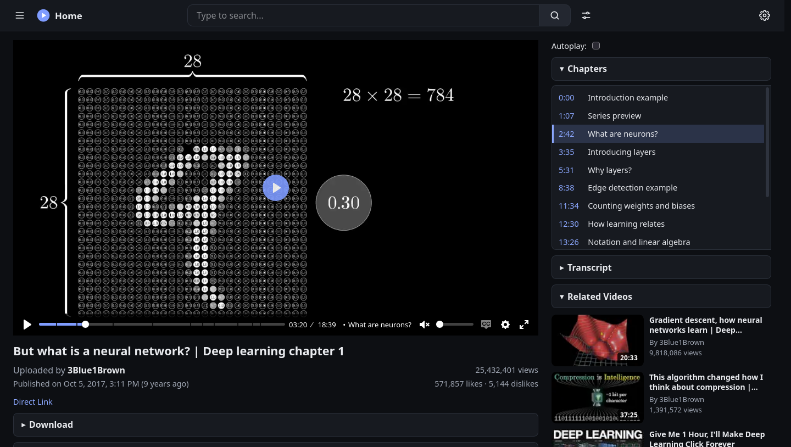
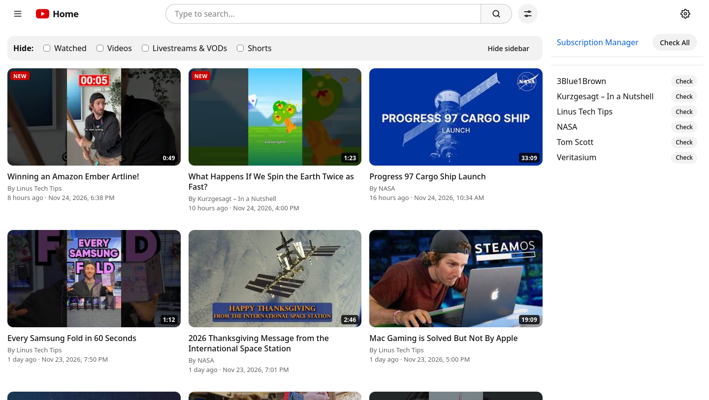
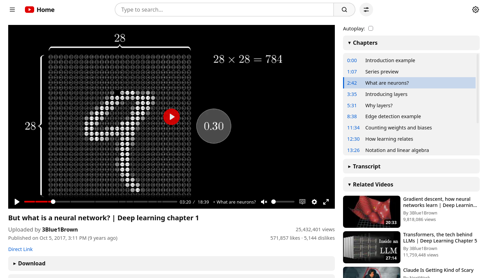
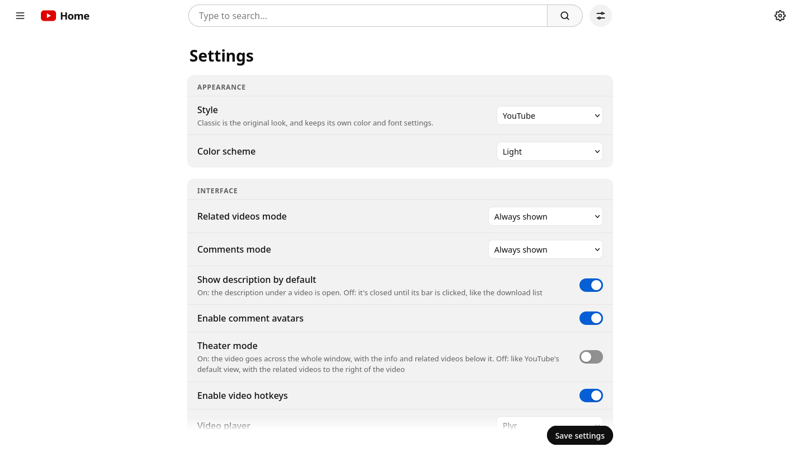

# youtube-local



This is a fork of [user234683/youtube-local](https://github.com/user234683/youtube-local) with a new interface, a reworked subscriptions feed, chapters, watch progress and more YouTube-style player controls. See [Added in this fork](#added-in-this-fork).

youtube-local is a browser-based client written in Python for watching Youtube anonymously and without the lag of the slow page used by Youtube. One of the primary features is that all requests are routed through Tor, except for the video file at googlevideo.com. This is analogous to what HookTube (defunct) and Invidious do, except that you do not have to trust a third-party to respect your privacy. The assumption here is that Google won't put the effort in to incorporate the video file requests into their tracking, as it's not worth pursuing the incredibly small number of users who care about privacy (Tor video routing is also provided as an option). Tor has high latency, so this will not be as fast network-wise as regular Youtube. However, using Tor is optional; when not routing through Tor, video pages may load faster than they do with Youtube's page depending on your browser.

The Youtube API is not used, so no keys or anything are needed. It uses the same requests as the Youtube webpage.

## Screenshots

**Modern style, dark:** watch page with chapters, the current chapter next to the time, and the dislike count



**YouTube style:** laid out like youtube.com





**Settings**, grouped by category, with options that only show when they apply



The original look is still there as the Classic style: [Gray theme](https://user-images.githubusercontent.com/28744867/64483431-8e1c8e80-d1b6-11e9-999c-14d36ddd582f.png), [Dark theme](https://user-images.githubusercontent.com/28744867/64483432-8fe65200-d1b6-11e9-90bd-32869542e32e.png), [Channel](https://user-images.githubusercontent.com/28744867/64483436-95dc3300-d1b6-11e9-8efc-b19b1f1f3bcf.png), [Downloads](https://user-images.githubusercontent.com/28744867/64483437-a2608b80-d1b6-11e9-9e5a-4114391b7304.png)

## Added in this fork

### Interface
* Three styles, picked under Settings → Appearance:
  * **Modern** (the new default): rounded cards, a sticky header and a grid of videos
  * **YouTube**: flat and laid out like youtube.com, with YouTube's colors and pill-shaped buttons
  * **Classic**: the original look, with its own Light/Gray/Dark themes and font choice
* Light and dark color schemes for the Modern and YouTube styles, or follow the system setting
* A side menu behind the ☰ button in the header. It's a dialog that closes with Escape, and still works as a plain link without JavaScript
* Redesigned settings page: grouped into Appearance, Interface, Playback, Network and Other, with toggle switches, a short explanation under each setting, and settings that don't apply to the chosen style hidden
* Choose which page opens at the root address: the home menu or subscriptions
* Local playlists are hidden by default. Set `local_playlists_enabled = True` at the top of `settings.py` to bring them back
* Theater mode is now off by default, so related videos sit to the right of the video like on YouTube

### Watch page
* **Chapters**, read from the timestamps in the description. The list in the sidebar seeks when clicked and highlights the chapter playing. The seek bar is split where chapters start, hovering it shows the chapter's name, and the current chapter is shown next to the time
* **Watch progress**: thumbnails everywhere show a bar for how far you got, and opening a video again resumes where you left off (a few seconds earlier, to catch up). `&t=` in the URL still takes priority
* **Dislike counts** from [Return YouTube Dislike](https://returnyoutubedislike.com/). It can be turned off in settings; when on, that site is sent the id of each video you open
* Exact upload date and time, as well as "9 years ago"
* Option to have the description collapsed until clicked
* Fixed videos freezing after seeking into a part that isn't buffered yet, mostly in Firefox

### Hotkeys
Closer to YouTube's:
* `Space` / `K` play and pause, `J` / `L` back and forward 10 seconds, `←` / `→` 5 seconds
* `↑` / `↓` change the volume by 5%, with the level shown over the video
* `0`–`9` jump to 0–90% of the video
* `,` / `.` pause and step one frame back or forward
* `Ctrl+←` / `Ctrl+→` previous and next chapter
* `F` fullscreen, `C` captions, `T` copy a link at the current time

### Subscriptions
* The feed is sorted by upload time, newest first, instead of by when a check found the video
* Each video shows how long ago it was uploaded and the exact date and time. "3 days ago" stays current while the page is open
* Videos uploaded in the last 12 hours get a **NEW** badge
* Hide watched videos, regular videos, livestreams & VODs, or shorts with checkboxes at the top. The choice is remembered
* Shorts and livestreams are told apart from regular videos when channels are checked
* Checking runs in the background: the Check buttons don't leave the page, and a box shows how many channels are done and how many videos were found
* Checks are cheaper: each channel's RSS feed is read first, and the bigger requests are only made when it shows something new. Estimated upload times ("2 weeks ago") are narrowed down and corrected as exact times come in
* The sidebar can be hidden, and stays hidden
* Redesigned subscription manager, with filtering and grouping by tag
* Database indexes so the feed and checks don't read the whole videos table on every page load

### Other
* Times are shown in a timezone set in settings (hours and minutes from UTC), so they don't depend on the server's timezone
* Pages load faster on reused connections (TCP_NODELAY on the server), and more connections are kept open per host, so thumbnails and video streams don't each start a new TLS connection
* Tests for chapters, the feed, watch progress and the styles in `tests/`

## Installing

### Windows

Download the zip file under the Releases page. Unzip it anywhere you choose.

### Linux/MacOS

Download the tarball under the Releases page and extract it. `cd` into the directory and run

```
python -m venv venv
source venv/bin/activate
pip install -r requirements.txt
python server.py
```

Depending on your distribution, you may need to use `python3` and `pip3` instead.

**Note**: If pip isn't installed, first try installing it from your package manager. Make sure you install pip for python 3. For example, the package you need on debian is python3-pip rather than python-pip. If your package manager doesn't provide it, try to install it according to [this answer](https://unix.stackexchange.com/a/182467), but make sure you run `python3 get-pip.py` instead of `python get-pip.py`

- Arch users can use the [AUR package](https://aur.archlinux.org/packages/youtube-local-git) maintained by @ByJumperX4
- RPM-based distros such as Fedora/OpenSUSE/RHEL/CentOS can use the [COPR package](https://copr.fedorainfracloud.org/coprs/anarcoco/youtube-local) maintained by @ByJumperX4


## Usage

To run the program on windows, open `run.bat`. On Linux/MacOS, first activate the virtual environment with `source venv/bin/activate` then run `python server.py`.

**Note for Mac users**: If you installed Python from the installer on python.org, you will need to have run the file `Install Certificates.command` in the directory `Applications/Python 3.x` where `x` is the minor version of python. Otherwise, you will get the error `certificate verify failed: unable to get local issuer certificate`. There is a similar file in that directory you can run to get the `python3` command installed for the terminal.

To run it at startup on Windows, right click `run.bat` and click "Create Shortcut." Then, move the shortcut to the Startup folder. You can access the Startup folder by pressing `Windows Key + R` and typing `shell:startup`.


Access youtube URLs by prefixing them with `http://localhost:8080/`, For instance, `http://localhost:8080/https://www.youtube.com/watch?v=vBgulDeV2RU`
You can use an addon such as Redirector ([Firefox](https://addons.mozilla.org/en-US/firefox/addon/redirector/)|[Chrome](https://chrome.google.com/webstore/detail/redirector/ocgpenflpmgnfapjedencafcfakcekcd)) to automatically redirect Youtube URLs to youtube-local. I use the include pattern `^(https?://(?:[a-zA-Z0-9_-]*\.)?(?:youtube\.com|youtu\.be|youtube-nocookie\.com)/.*)` and the redirect pattern `http://localhost:8080/$1` (Make sure you're using regular expression mode).

If you want embeds on the web to also redirect to youtube-local, make sure "Iframes" is checked under advanced options in your redirector rule.

youtube-local can be added as a search engine in firefox to make searching more convenient. See [here](https://support.mozilla.org/en-US/kb/add-or-remove-search-engine-firefox) for information on firefox search plugins.

### Portable mode

If you wish to run this in portable mode, create the empty file "settings.txt" in the program's main directory. If the file is there, settings and data will be stored in the same directory as the program. Otherwise, settings and data will be stored in `C:\Users\[your username]\.youtube-local` on Windows and `~/.youtube-local` on Linux/MacOS.

### Using Tor

In the settings page, set "Route Tor" to "On, except video" (the second option). Be sure to save the settings.

Ensure Tor is listening for Socks5 connections on port 9150. A simple way to accomplish this is by opening the Tor Browser Bundle and leaving it open. However, you will not be accessing the program (at https://localhost:8080) through the Tor Browser. You will use your regular browser for that. Rather, this is just a quick way to give the program access to Tor routing.

### Standalone Tor

If you don't want to waste system resources leaving the Tor Browser open in addition to your regular browser, you can configure standalone Tor to run instead using the following instructions.

For Windows, to make standalone Tor run at startup, press Windows Key + R and type `shell:startup` to open the Startup folder. Create a new shortcut there. For the command of the shortcut, enter `"C:\[path-to-Tor-Browser-directory]\Tor\tor.exe" SOCKSPort 9150 ControlPort 9151`. You can then launch this shortcut to start it. Alternatively, if something isn't working, to see what's wrong, open `cmd.exe` and go to the directory `C:\[path-to-Tor-Browser-directory]\Tor`. Then run `tor SOCKSPort 9150 ControlPort 9151 | more`. The `more` part at the end is just to make sure any errors are displayed, to fix a bug in Windows cmd where tor doesn't display any output. You can stop tor in the task manager.

For Debian/Ubuntu, you can `sudo apt install tor` to install the command line version of Tor, and then run `sudo systemctl start tor` to run it as a background service that will get started during boot as well. However, Tor on the command line uses the port 9050 by default (rather than the 9150 used by the Tor Browser). So you will need to change `Tor port` to 9050 and `Tor control port` to 9051 in the youtube-local settings page. Additionally, you will need to enable the Tor control port by uncommenting the line `ControlPort 9051`, and setting `CookieAuthentication` to 0 in `/etc/tor/torrc`. If no Tor package is available for your distro, you can configure the `tor` binary located at `./Browser/TorBrowser/Tor/tor` inside the Tor Browser installation location to run at start time, or create a service to do it.

### Tor video routing

If you wish to route the video through Tor, set "Route Tor" to "On, including video". Because this is bandwidth-intensive, you are strongly encouraged to donate to the [consortium of Tor node operators](https://torservers.net/donate.html). For instance, donations to [NoiseTor](https://noisetor.net/) go straight towards funding nodes. Using their numbers for bandwidth costs, together with an average of 485 kbit/sec for a diverse sample of videos, and assuming n hours of video watched per day, gives $0.03n/month. A $1/month donation will be a very generous amount to not only offset losses, but help keep the network healthy.

In general, Tor video routing will be slower (for instance, moving around in the video is quite slow). I've never seen any signs that watch history in youtube-local affects on-site Youtube recommendations. It's likely that requests to googlevideo are logged for some period of time, but are not integrated into Youtube's larger advertisement/recommendation systems, since those presumably depend more heavily on in-page tracking through Javascript rather than CDN requests to googlevideo.

### Importing subscriptions

1. Go to the [Google takeout manager](https://takeout.google.com/takeout/custom/youtube).
2. Log in if asked.
3. Click on "All data included", then on "Deselect all", then select only "subscriptions" and click "OK".
4. Click on "Next step" and then on "Create export".
5. Click on the "Download" button after it appears.
6. From the downloaded takeout zip extract the .csv file. It is usually located under `YouTube and YouTube Music/subscriptions/subscriptions.csv`
7. Go to the subscriptions manager in youtube-local. In the import area, select your .csv file, then press import.

Supported subscriptions import formats:
- NewPipe subscriptions export JSON
- Google Takeout CSV
- Old Google Takeout JSON
- OPML format from now-removed YouTube subscriptions manager

## Contributing

Pull requests and issues are welcome. Please do not submit AI generated pull requests or issues.

For coding guidelines and an overview of the software architecture, see the HACKING.md file.

## License

This project is licensed under the GNU Affero General Public License v3 (GNU AGPLv3) or any later version.

Permission is hereby granted to the youtube-dl project at [https://github.com/ytdl-org/youtube-dl](https://github.com/ytdl-org/youtube-dl) to relicense any portion of this software under the Unlicense, public domain, or whichever license is in use by youtube-dl at the time of relicensing, for the purpose of inclusion of said portion into youtube-dl. Relicensing permission is not granted for any purpose outside of direct inclusion into the [official repository](https://github.com/ytdl-org/youtube-dl) of youtube-dl. If inclusion happens during the process of a pull-request, relicensing happens at the moment the pull request is merged into youtube-dl; until that moment, any cloned repositories of youtube-dl which make use of this software are subject to the terms of the GNU AGPLv3.

## Donate

- Bitcoin: bc1qnxfm8mk2gdcdr56308794a4f97dd7wu6qawguw
- Monero: 469tczUEVTX6Y7bMEgTyrUJ2K7R8qVNjn5eh5VVHKvi4QsbMD7vrFW8RaCqM1jmZMR9GM87yByvPKZb8gsSxUzrdGCM1yXv
- Ethereum: 0x04828FFa6fa8F68535A22153300e50AfCDC342C4

## Similar projects
- [invidious](https://github.com/iv-org/invidious) Similar to this project, but also allows it to be hosted as a server to serve many users
- [Yotter](https://github.com/ytorg/Yotter) Similar to this project and to invidious. Also supports Twitter
- [FreeTube](https://github.com/FreeTubeApp/FreeTube) (Similar to this project, but is an electron app outside the browser)
- [yt-local](https://git.sr.ht/~heckyel/yt-local) Fork of this project with a different page design
- [NewPipe](https://newpipe.net/) (app for android)
- [mps-youtube](https://github.com/mps-youtube/mps-youtube) (terminal-only program)
- [youtube-viewer](https://github.com/trizen/youtube-viewer)
- [smtube](https://www.smtube.org/)
- [Minitube](https://flavio.tordini.org/minitube), [github here](https://github.com/flaviotordini/minitube)
- [toogles](https://github.com/mikecrittenden/toogles) (only embeds videos, doesn't use mp4)
- [youtube-dl](https://rg3.github.io/youtube-dl/), which this project was based off
